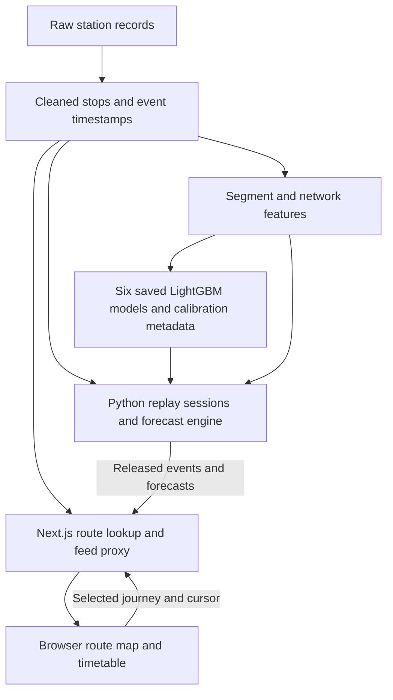

# RaahAI Train Arrival Delay Forecasting for Indian Railways

Final-year academic project report · November 2026

## Chapter 1 Introduction

### 1.1 Background

Railway timetables specify the planned sequence and timing of station calls. They also provide the reference against which punctuality is measured. During an actual journey, the running time between stations and the time spent at each stop can differ from their scheduled values. A train may lose time during one segment and recover part of it later. The size and direction of that change can vary across journeys of the same service. An arrival estimate therefore depends on the train’s current progress, the remaining route and the amount of time ahead for which a forecast is required. The railway prediction literature identifies the forecasting horizon and the information available at prediction time as important dimensions of this problem [1].

The National Train Enquiry System (NTES), developed by the Centre for Railway Information Systems, disseminates near-real-time running information and exposes passenger enquiry functions. The Real-time Train Information System (RTIS) serves a different role in the official environment by automating acquisition of train-movement data using equipment on trains and locomotives. Together, the systems illustrate two distinct parts of the information process. Movement observations must first be acquired and timestamped. The resulting information can then be delivered in a form appropriate for a passenger or an operator [2], [3].

RaahAI is an academic project in applied machine learning, transportation data analysis and web application development. It uses recorded Indian railway station observations to develop and evaluate a station-level forecasting workflow. A Python pipeline converts raw journey records into analysis-ready features, trains quantile models and stores the resulting model files. A web application presents a route map and timetable for a selected journey. A separate replay server releases the observations at their simulated availability times, allowing the timetable to show how downstream forecasts change as reports arrive [4].

### 1.2 Motivation

A passenger planning to board or meet a train needs information about a particular station, often before the train has reached the previous one. The scheduled arrival provides a starting point, but its usefulness decreases when the train is already running late or when a disruption changes its progress. A recent station report gives a more current view of the journey. Converting that report into a downstream forecast requires an estimate of how much delay will persist or be recovered over the remaining segments.

Forecasts also need to convey uncertainty. A prediction of 15 minutes late may be suitable as a central estimate, yet its practical value depends on whether the plausible variation is a few minutes or substantially larger. The uncertainty can increase with the number of remaining stops and with gaps in reporting. A timetable that displays both a central estimate and a forecast range allows users to interpret those two quantities separately. Historical validation can subsequently determine how often the ranges contain recorded delays and whether their widths are useful [1].

The project also responds to an evaluation problem. A historical file may contain the complete sequence of arrival and departure records even though those records became available at different times. During testing, a model can appear more accurate if it receives a later observation before the time when it could have been used. RaahAI makes the sequence observable by releasing recorded reports through a replay clock. The retained forecast can then be checked against the recorded arrival, using an issue time that precedes the target event. This also allows the same journey to be replayed for demonstrations, troubleshooting and regression checks [4].

### 1.3 Problem statement

Given a train identifier, the journey’s start date, its scheduled route and the data available at a particular issue time, the system must estimate the signed arrival delay at each eligible downstream station. For a target station B, the observed arrival delay d(B) is the actual arrival time at B minus the scheduled arrival time at B, expressed in minutes. A positive value indicates late arrival and a negative value indicates early arrival. A missing observation remains missing. A value of zero represents an on-time observation when the underlying timestamps support that interpretation.

Arrival delay at a station and delay change over a segment are separate quantities. If a train departs station A 63 minutes late and reaches station B 41 minutes late, its recorded delay at B is 41 minutes. The change over the segment is 41 − 63 = −22 minutes, meaning that 22 minutes were recovered. The distinction determines how the forecasting model is used. The live model estimates the change relative to an upstream observed delay, then adds that upstream delay back to express the result in the same units as the timetable [4].

The project considers two information regimes. Before departure, the system uses scheduled characteristics and historical summaries to estimate the delay at each eligible target. After a station event becomes available, it can also use the observed delay and information derived from earlier events on that journey. An observation at the target itself can establish the recorded outcome and is unavailable to a forecast issued before that arrival. The operational question is how much forecast error is reduced when legitimate upstream observations are incorporated.

The application must present these quantities in a form that a reader can distinguish at a glance. The pre-departure forecast answers what the model expected using information available before the journey was under way. The updated forecast answers what the model expected after an upstream report. The recorded delay states what was subsequently observed. Identifying the report behind an update helps explain when and why a prediction changed. The expected arrival, where calculated in the forecasting workflow, is the scheduled arrival plus the predicted signed delay.

### 1.4 Project objectives

1. Prepare a consistently ordered dataset of dated railway stops and derived segments. Preserve the distinction between genuinely observed outcomes, missing records and approximate values produced during preprocessing.
2. Develop a multi-stop forecasting method that estimates a central arrival delay and a lower-to-upper delay range. Support both initial forecasting and revision from current station observations.
3. Provide a route finder that accepts a train number or name and associates the result with a specific journey date. Present the ordered stops, scheduled times, available coordinates and relevant forecast or observation fields.
4. Simulate the arrival of station reports from the validation and test periods. Release each record according to its availability, maintain the clock independently for each replay session and refresh forecasts for remaining stations.
5. Compare the saved model with suitable baselines and measure performance at several horizons. Report error and range coverage over chronological evaluation sets, with separate treatment of the interactive replay and supplemental later-day experiment.
6. Demonstrate a complete, inspectable forecast cycle in which an upstream event changes a prediction and a later arrival report confirms the outcome. Preserve the last eligible estimate for comparison and communicate the limits imposed by delayed or missing reports.

### 1.5 Scope of the project

The project’s data scope is recorded Indian railway station histories. The independent dataset was assembled from a publicly reachable train-status cache and supplied as per-train CSV files. Those histories contain station codes, train identifiers, dates, scheduled timings and, where reported, actual timings and other observation fields. The raw audit counted 204,074,293 rows across 12,935 trains. The cleaned 2026 dataset contains 28,101,853 stop rows, approximately 1.97 million journeys and 12,758 train partitions. These figures describe distinct stages of the data pipeline. Model fitting uses derived segments and sampled forecasting pairs with separate denominators [4].

The model scope covers predictions for a known train, date and route. It uses planned times and route features before the journey starts, then augments them with released station observations. The interactive scope comprises a local browser application and a replay server. The map links recorded stations with available coordinates in route order. A corresponding timetable supplies the station-level detail needed to compare predictions and observations. Replay is available for recorded dates in July or August 2026 that contain timestamped station events [4].

The experimental scope is defined by the journey start date. Journeys before July 2026 in the prepared year were used for model fitting. July was used for validation, and August was reserved for held-out testing. The additional September 1 evaluation is a later one-day check and has its own sample characteristics. If a journey begins on August 31 and continues after midnight, the whole journey is assigned according to its August start date. This rule keeps different stops of one journey in the same partition [4].

The local system demonstrates passenger information and forecast evaluation. Deployment with present-day train operations, continuous location telemetry, direct measurements of disruptions and the suitability of predictions for dispatch or safety decisions require separate integration and validation. The project’s evidence addresses the recorded routes, dates and observation conditions used in its experiments. Those boundaries define the claims that can be made from the results.

## Chapter 2 Related Work

### 2.1 Operational train information systems

Operational train information systems establish how a passenger-facing service acquires and presents current status. CRIS describes NTES as a mechanism for providing near-real-time train running information, including enquiries about scheduled services and the progress of a particular train. The ISRO account of RTIS describes arrangements for acquiring movement information from operating trains and delivering it to railway information systems. These services show why trustworthy timestamps and event provenance are important. A consumer must know which movement an observation describes and how recently the information became available [2], [3].

The proposed system considers a related forecasting task using an independent historical dataset. It re-creates the flow of station reports and exposes the predicted range and the report used to update it. The official services are relevant comparison points for data acquisition and passenger information. A quantitative comparison with their operational arrival estimates would require matching messages, source timestamps and target arrivals from the same journeys. Such a comparison lies beyond the available dataset and experimental protocol.

### 2.2 Research on railway delay forecasting

Tiong, Ma and Palmqvist review data-driven methods for train delay prediction from problem definition through modelling and evaluation. They identify distinctions between short- and long-horizon problems and between prediction tasks that use historical aggregates and those that use current observations. Their review emphasizes that input availability and prediction objectives should drive the choice of model and evaluation. It also identifies data quality, validity and interpretability as important areas for improvement. These considerations motivate the proposed system’s separate pre-departure and updated modes, as well as evaluation by the number of stops ahead [1].

Marković et al. examine passenger train arrival delays using support vector regression and compare their approach with artificial neural networks on Serbian railway data. Their formulation relates arrival delays to train, timetable and infrastructure characteristics. It demonstrates the value of structured operational features for a regression task. The study’s use of railway-specific inputs also illustrates a transferability issue. Variables that describe infrastructure or operating conditions in one railway may be unavailable or may have different definitions elsewhere. A model for the available Indian dataset must draw on the route geometry, timetable and historical station records that can be represented consistently [5].

Kecman and Goverde study online, data-driven prediction of railway event times. Their approach uses operational event information and historical process-time estimates to update predictions. The study helps explain why timing and availability matter when describing a forecast as online. An arrival report, the subsequent departure and an estimate based on the latter are distinct events. With station-level recordings, the forecast must reflect whichever upstream report has actually arrived. The source information in RaahAI’s timetable addresses this aspect by indicating the station and event type that support the update [6].

Oneto et al. discuss train delay prediction at the scale of a large railway network. They describe using historical delay profiles and data analytics to support forecasts as trains progress. Their work places model development within a larger system for managing operational data and generating timely forecasts. The proposed project adopts the system-level perspective while using its own data representation and evaluation protocol. It brings data preparation, forecasting and a user-visible update sequence together around a selected train journey [4], [7].

Taken together, these contributions support three design decisions. Operational features should reflect the data that can be collected consistently for the railway under study. Forecast accuracy should be evaluated at more than one horizon. Finally, a system that claims to use online information should specify which data were available at each forecast issue time. Comparing published MAE values directly across studies would require common inputs, horizons, targets and scoring conditions. The project therefore compares methods on its own chronological splits and reports the relevant sample sizes [1], [5]–[7].

### 2.3 Comparative analysis

| Source or system | Approach and evidence | Design implication for RaahAI |
|---|---|---|
| Tiong, Ma and Palmqvist [1] | Reviews data-driven prediction designs, inputs, horizons and evaluation | Specify the operational question and report accuracy by forecast horizon |
| NTES and RTIS [2], [3] | Disseminate passenger information and acquire train movement observations in the official ecosystem | Preserve the distinction between observation time, reported status and model output |
| Marković et al. [5] | Compares support vector regression and neural-network methods using Serbian railway inputs | Use supervised regression and select operational variables available in the target dataset |
| Kecman and Goverde [6] | Studies adaptive online prediction of railway event times | Refresh downstream estimates when new upstream events become available |
| Oneto et al. [7] | Uses historical train delay profiles in a large-scale forecasting system | Represent repeated service histories and connect modelling to an application workflow |

An additional comparison concerns the role of simple baselines. Carrying forward the currently observed delay provides a direct reference for an updated forecast. It can be competitive at short horizons when little happens between two stops. A historical arrival-delay average provides a reference before departure, when the current run supplies no observations. Comparing an updated model only with an initial forecast would combine the benefit of having new information with the benefit of learning from it. A persistence baseline helps distinguish these contributions on the same test targets [4].

The deployed model uses LightGBM, a gradient-boosted decision-tree implementation described by Ke et al. The input combines numerical route characteristics with categorical and time-varying fields. Tree boosting can learn conditional relationships among those variables, such as differences in the influence of current delay across short and long forecast horizons. Quantile regression provides the statistical basis for estimating multiple points of the conditional delay distribution. The project uses the 10th, 50th and 90th quantiles and calibrates the interval using validation data. Empirical inclusion and interval width are both relevant when judging the resulting range [8], [9].

The project also contains a smaller exploratory comparison of six algorithms on sampled next-stop data. That experiment supports model investigation under common inputs, but its objective and sample differ from those of the deployed multi-stop quantile model. Evidence about model choice should distinguish a point estimate on that sample from performance over multiple horizons and the validity of predicted ranges. The final evaluation therefore treats the exploratory benchmark, the August test and the simulated replay as different experimental protocols [4].

### 2.4 Research gap

Existing studies establish that railway delays can be modelled from operational histories and that forecasts can be updated when new observations arrive. The gap addressed by this project is an application and evaluation gap within the available Indian station records. The project requires a reproducible way to take a train and date from those records, issue a multi-stop forecast, introduce data as it becomes available and then compare each forecast with the corresponding observation. Published studies provide methods and precedents for this workflow, while the project must establish that it works for its own records and implementation [1], [4]–[7].

The target data introduce specific constraints. Observation density varies by train and station, and the available events primarily describe progress at station stops. A model may successfully account for an existing delay while missing a new disruption between reports. A single aggregate score can obscure this distinction. The project addresses it through evaluations by forecast horizon and by the sequence of observed delays. The timetable also retains the before-departure forecast for direct comparison with the updated prediction and recorded outcome [4].

Another requirement is to communicate uncertainty at the same granularity as the arrival estimate. The next stop and a station many stops ahead can have markedly different forecast ranges. A visual route and timetable let the user locate each prediction in the journey sequence. Storing the observed result beside the corresponding forecast then enables empirical checks of whether a central estimate was accurate and whether its interval covered the arrival. The project contribution is the integration and evaluation of these capabilities for the selected dataset.

### 2.5 Response to the gap

The proposed system uses two model configurations defined by what can be observed at forecast time. It generates a preliminary multi-stop prediction from schedules and historical features. After a report is released, the system combines the observed delay with the saved models’ prediction of downstream delay change. The replay clock and event issue times provide the temporal boundary needed to reconstruct this process. The same train and date can be replayed repeatedly with an independent session, supporting repeatable demonstrations and debugging [4].

Finally, chronological test design links the literature to the implementation. The deployed configuration uses July data for validation and August journeys for held-out assessment. Stops are scored only when the suitable model output and the corresponding observation exist. Where the studies motivate broader topics such as real operational integration or transfer across railway systems, the project limits its claims to the recorded data and identifies further validation as a separate stage. This framing makes clear what the prototype demonstrates and what empirical work would be required for operational use [1], [4].

## Chapter 3 Requirement Specification

### 3.1 Functional requirements

#### 3.1.1 Users and operating assumptions

The primary user is a person inspecting a recorded journey through the route finder. That user may know a train number or only part of its name. After selecting a result and an available date, the user needs to see the sequence of stations, the corresponding schedule, and any forecast or observation associated with each station. The academic demonstrator also needs a repeatable way to start a replay and explain how the displayed values change. The developer or evaluator needs a reproducible set of data and model artifacts, together with endpoint responses that can be inspected independently of the browser.

The system identifies a journey using the train number and the date on which the service began. Train names support search, while the number and date identify the records to load. Station codes can recur along some routes, so the stop index also matters when linking feed events and forecasts to timetable rows. Scheduled or actual times may extend into the following day. That day offset must be visible in the timetable and reflected in time calculations [4].

#### 3.1.2 Route search and forecasting

| ID | Requirement | Expected behaviour |
|---|---|---|
| FR1 | Search the train catalog | An exact train number resolves directly when present. A broader search lists matching services by number or name. |
| FR2 | Select a dated journey | The date selector lists available records for the selected train. The system loads the route for the chosen date. |
| FR3 | Show route geography | The map uses stations with available coordinates and connects them in recorded stop order. Station selection links the timetable to the map. |
| FR4 | Show schedule and observations | The timetable presents scheduled arrival and departure, recorded arrival and delay, and available platform and distance information. |
| FR5 | Provide a pre-departure forecast | The system applies the saved Python models and displays the predicted delay and range where the required feature records are available. |
| FR6 | Inspect a historical update | A user can select an earlier stop with a recorded delay and inspect the resulting predictions for later stops. |

The initial route view also summarizes the first and last stops present in the selected record, the count of recorded stops and the available schedule and distance information. These endpoints describe the selected data record, which can cover only part of a service. A stop remains in the timetable when coordinates are unavailable. If starting a prediction fails or a value is missing, the interface must indicate that state. For example, displaying zero for a missing arrival would imply the train arrived on time and would distort both the interface and any subsequent accuracy calculation [4].

#### 3.1.3 Simulated feed and scoring

| ID | Requirement | Expected behaviour |
|---|---|---|
| FR7 | Start a replay for the selected journey | Use the selected train and date when starting a new local session. The accepted journey dates are in July or August 2026, subject to available observations. |
| FR8 | Deliver observations incrementally | Release arrivals and departures in simulated time order. Use a cursor so repeated requests retrieve newly available reports. |
| FR9 | Update downstream forecasts | Use released observations to update the eligible downstream rows and display the source station and whether the report was an arrival or departure. |
| FR10 | Reveal recorded outcomes at the correct point | Fill arrival and delay cells when the arrival report for that stop becomes available in replay. |
| FR11 | Preserve the forecast used for scoring | For a reported target, retain the latest forecast issued before actual arrival. Compare the updated and initial estimates on the same eligible stops. |
| FR12 | Communicate replay state | Display the simulation clock, speed, latest report, connection or completion state, and a control to restart. |

The two viewing modes present the same journey for different purposes. In historical inspection, applicable recorded values are already available. In the simulated feed view, values become visible as reports are released. Reports about departure may alter the prediction for later stations without filling the recorded arrival cell for the departure station. At the origin, for example, a departure report can provide the first delay used by the live model while the journey still has no observed arrival at that stop. This distinction is important when verifying that the timetable is responding correctly [4].

### 3.2 Non-functional requirements

#### 3.2.1 Temporal integrity and reproducibility

The replay service must enforce the boundary between past and future information. A station event becomes available at the later of its actual event time and the associated report timestamp. The engine constructs current-journey inputs using the released event history. Time fields remain consistent across the API and user interface, and the interface displays IST. A forecast may be included in replay MAE only if its issue time is earlier than the target’s actual arrival time. This rule prevents a late upstream report from being credited for an outcome that had already occurred [4].

Repetition of an experiment requires a recorded train and start date, the relevant prepared feature partition, the saved model and metadata, and a defined protocol for choosing the scored observations. Experiments must identify the split and population used. This is particularly important because the model test scores sampled forecasting pairs, whereas the replay scores recorded arrivals with an eligible prior forecast. The local playback speed controls waiting time during a demonstration while event order and recorded timestamps follow the source data.

#### 3.2.2 Performance and service behaviour

Route search should resolve the selected train through the catalog and load only the necessary journey partition for itinerary display. The feed must support repeated polling throughout the replay. The browser schedules its next check about one second after completion of the current request. This describes the refresh cadence. An end-to-end response time also includes request overhead and, on a first load, journey preparation. Model loading and preparation costs should be considered separately from steady-state polling. The local project has no measured production throughput or response-time guarantee [4].

The display should distinguish waiting for a new station observation from an unavailable or completed feed. The simulated clock can advance while a prediction remains unchanged. This is expected during a gap between station reports. Independent replay sessions and a restart control allow the same journey to begin again from its opening report. During a demonstration, these controls prevent progress in one session from determining the starting point of another [4].

#### 3.2.3 Usability and presentation of uncertainty

The interface should use straightforward labels for scheduled, predicted and observed values. Delays appear in minutes with a sign where applicable. Missing values use a separate visual convention. The forecast origin label should identify the upstream event supporting the updated estimate, and the interval should remain associated with the applicable forecast. A table provides a readable route representation when location data or base map tiles are unavailable.

Coverage is a property of the evaluation sample, so the interface should communicate the range as a forecast interval. A previously observed coverage rate does not indicate that a particular station’s actual arrival must fall inside its displayed interval. A suitable presentation also preserves both the coverage and the width when reporting results, since an excessively wide interval can be difficult to act on even when aggregate coverage is high [1], [4], [9].

#### 3.2.4 Maintainability and boundaries

Data preparation and model inference should remain in the Python components responsible for the saved models. The browser reads outputs through the web service and displays values with consistent sign and time conventions. Changes to the prediction model should be traceable to a new set of artifact files and a documented evaluation protocol. The site and simulator use separate local processes, so a feed issue can be diagnosed independently of route search and historical journey loading [4].

The current prototype runs on loopback interfaces. A public deployment would require a separate review of the right to redistribute the source records, service authentication, access limits, operational monitoring and maintenance of verified data. These considerations define requirements for a future deployment and should be kept distinct from the local testing results.

### 3.3 Hardware requirements

| Component | Local development and verification environment | Requirement interpretation |
|---|---|---|
| Processor | AMD Ryzen 5 5600H, 12 logical processors visible to the operating system | A general-purpose 64-bit processor can run the demonstrated setup. Training benefits from parallel CPU processing. |
| Memory | Approximately 15.34 GiB visible to Windows | The figure describes the verification host. Minimum memory and peak training usage require measurement. |
| Prepared data storage | About 2.03 GB for cleaned 2026 files and 3.45 GB for feature files, measured in decimal GB | Local inference needs the relevant prepared datasets and model artifacts. Full preparation requires additional space for inputs and intermediate files. |
| Model and evaluation files | Approximately 206 MB in the multi-stop model directory, including evaluation artifacts | Inference loads the saved boosters and feature metadata. Evaluation outputs also occupy space in the workspace. |
| Display and connectivity | A modern browser, loopback access to both services, and network access for OpenStreetMap background tiles | The browser must be able to access the local web service. The timetable remains useful when map tiles are unavailable. |

The table records the actual development and verification host and the measured size of selected directories. It should be read as the environment used for the current work. The raw audit indicates a considerably larger archive than the prepared runtime data. A full rebuild must allow storage for that archive and for concurrently retained intermediate outputs, including the cleaned stop tables and derived feature partitions. During a presentation, the stored partitions and trained artifacts make it possible to demonstrate the system without repeating training [4].

### 3.4 Software requirements

| Layer | Software | Role in the project |
|---|---|---|
| Host environment | 64-bit Windows, build 26100, and Python 3.10.22 from the project environment | Runs local scripts, HTTP services and reproducible command-line inference |
| Data pipeline | pandas 2.3.3, NumPy and PyArrow 25.0.1 | Normalizes observations and reads or writes the partitioned Parquet datasets [10] |
| Training and inference | LightGBM 4.7.0 in the inspected environment | Executes the saved quantile models using their stored feature metadata [8] |
| Web runtime | Node.js 24.16.0 and Next.js 16.4.6 | Hosts the route finder and HTTP Route Handlers for local requests [11] |
| User interface | React, TypeScript and Tailwind CSS | Implements the interactive search, journey selection, timetable and feed state |
| Mapping | React Leaflet 5.0.0, Leaflet 1.9.4 and OpenStreetMap tiles | Displays station markers and connects them in stop order [12] |
| Replay and testing | Python standard-library HTTP server, model evaluation scripts and the benchmark notebook | Releases ordered observations, supports independent replay sessions and documents experimental results |

The prepared Parquet datasets, train catalog and model files are input dependencies for local operation. The web service uses Next.js Route Handlers to call the local forecast tools or forward a feed request. The Python service resolves the selected partition, constructs the replay and returns the currently available events and forecasts. These roles allow the timetable to use the same saved model files as the evaluation scripts [4], [10], [11].

### 3.5 Acceptance and verification criteria

| Scenario | Observable acceptance criterion |
|---|---|
| Journey selection | Searching for a known train opens its route and permits selection of an available date. |
| Missing values | A stop with an unavailable arrival or coordinate remains in the timetable and displays an appropriate missing-value indicator. |
| Replay connection | The web application requests a session for the currently selected train and date, and subsequent requests advance that session using its cursor. |
| Forecast refresh | A released upstream observation generates applicable forecasts for later stops, with its source indicated beside the updated delay. |
| Arrival release | The target row fills its recorded arrival and delay when the event becomes available, and the eligible forecast remains visible for comparison. |
| Chronological scoring | Assessment includes only forecasts available before the target arrival and uses the same target population for the paired MAE comparison. |
| Replay restart | A fresh session starts again at the opening report, independently of existing clients. |

An integration check exercised this sequence for train 18181 on 31 August 2026. The TATA departure report produced an updated forecast at CNI. The CNI arrival report then supplied the recorded delay and arrival time for the same row. This check establishes that route selection, session creation, station matching and update display operate together for the demonstrated journey. Accuracy testing uses larger samples and is evaluated separately from acceptance of the interface [4].

## Chapter 4 Problem Design and Experimental Setup

### 4.1 System architecture

The architecture separates data preparation, model fitting and interactive inference. This separation allows the same model artifacts to be evaluated offline and used by the application. It also makes inspection of a forecast possible at the level of a particular journey, station and observation. The route finder and Python feed service run as distinct local processes, while the prepared data and saved model files provide common inputs [4].

Figure 4.1. Offline preparation and runtime architecture.

The offline pipeline begins with raw station CSV files. Import converts the records into partitioned data. Cleaning resolves observation timestamps, prepares stop order and produces files suitable for constructing segments. Feature engineering combines segment history, schedule information and network context. The training routine evaluates the resulting inputs on chronological splits and exports six LightGBM models and supporting metadata. The Parquet layout allows the application to access individual train partitions without scanning the entire dataset for each journey [4], [8], [10].

At runtime, the Next.js route finder resolves a train search through a catalog and loads the selected journey. It presents station markers and a line that follows the recorded stop order. Basemap tiles are supplied by OpenStreetMap, and the markers and connecting line are rendered using Leaflet. The timetable provides the full sequence of recorded stops, including rows without coordinates. The Next.js backend also exposes a same-origin route for polling the local Python service. Using Route Handlers gives the web application a defined interface for HTTP requests while leaving model execution in Python [4], [11], [12].

The Python service manages the simulated clock and the sequence of observation releases. Each web replay uses a session associated with the selected train and date. The service prepares a sequence of forecasts by processing the events in their release order. It publishes only the prefix and forecast snapshot corresponding to the current simulated time. This design allows the preparation cost to be paid at the start of a journey and reused for subsequent sessions while preserving the same information boundary at each replay step [4].

### 4.2 Data flow and feature construction

#### 4.2.1 From station observations to usable journeys

The dataset is an independent collection of recorded train-stop information derived from a public train-status cache. The raw audit counted 204,074,293 rows across 12,935 trains. The 2026 cleaning log reports that 28,101,853 stop rows were written, representing 1,968,311 journeys in 12,758 train partitions. A row in this cleaned dataset describes one stop on one journey. A model test pair describes an upstream information state and a downstream target, and several pairs can derive from the same journey. The number of station observations, journeys and forecasting examples therefore describes different aspects of the experimental population [4].

Cleaning combines the separate date and time fields into comparable timestamps, normalizes station and service identifiers, and uses the available reporting flags to determine whether arrival and departure information is valid. The pipeline checks sequence, timing and distance consistency. It corrects identifiable calendar shifts and masks implausible observations. Missing observations are preserved in the cleaned data. The segment representation includes indicators for arrivals treated as approximate, enabling their inclusion to be audited separately from the recorded-arrival replay [4].

The journey start date remains the grouping key for chronological splitting. The scheduled and actual clocks can advance into a later calendar day as the train progresses. Assigning all stops according to the original journey date prevents a midnight boundary from separating the earlier and later portions of a train run. The frontend displays the corresponding day offset where needed.

#### 4.2.2 Schedule history and current journey features

A segment links two adjacent recorded stops. Scheduled running time is derived from the upstream departure and downstream arrival. Dwell time is derived from the scheduled arrival and departure at a station. Distance and station locations characterize the route geometry. Historical segment statistics include measures of typical delay gain, dispersion and extremes over windows of 7, 30 and 90 days. Aggregation is keyed by train and directed station pair, and the rolling windows exclude the current journey date. Network features also use prior-day summaries and schedule-based traffic counts, including activity near target stations and indicators of traffic on the same or opposing sections [4].

For a forecast from upstream stop A to target stop B, the live model receives the current delay, its source and applicable observations from earlier stops. Examples include dwell overrun, recent delay gains and the largest observed departure delay so far. It also receives information about the path from A to B, including the number of stops ahead, scheduled travel time, route distance and aggregated historical characteristics. When a replay report supplies an arrival but the train has yet to leave, departure-related values for that stop remain missing until an applicable report is released. This preserves the distinction between the two events.

| Feature family | Representative inputs | Availability rule |
|---|---|---|
| Schedule and service | Scheduled running time, dwell, time of day, service type | Available from the timetable and service record |
| Route and horizon | Segment distance, station coordinates, stops ahead, scheduled time remaining | Derived from the prepared route |
| Historical performance | Prior 7-, 30- and 90-day segment summaries, station delay history | Computed from records with earlier journey dates |
| Network context | Scheduled traffic counts and historical section aggregates | Uses timetable context and prior observations |
| Current journey | Latest known delay, observation type, earlier gains and dwell overrun | Derived from released upstream observations for replay |

### 4.3 Proposed methodology

#### 4.3.1 Target and quantile objectives

Let Tˢ(B) be the scheduled arrival time at station B and Tᵃ(B) its actual arrival. The target delay is d(B) = Tᵃ(B) − Tˢ(B), expressed in minutes. The pre-departure models estimate d(B) directly. Given an observed upstream delay k(A), the live models estimate the residual d(B) − k(A). Adding k(A) back to a live-model prediction restores the absolute delay at B on the timetable’s scale. Forecasting the change in delay lets the model represent gain or recovery along the route while carrying forward the magnitude already observed at A [4].

Each information regime uses one LightGBM model per quantile, with levels 0.10, 0.50 and 0.90. For a residual u defined as target minus forecast, the quantile loss at level q is max(q × u, (q − 1) × u). This asymmetric loss provides a way to estimate selected points of a conditional distribution. At q = 0.50 the penalty is symmetric. Validation quantile loss supports early stopping, and the deployed artifacts retain the fitted models, feature order, categorical values, range scales and blend weights [4], [8], [9].

The three independently estimated values can cross. The prediction routine sorts them into L, M and H and uses M as the central estimate. Given a scale s, the lower end is M − s(M − L) and the upper end is M + s(H − M). The validation routine selects the smallest tested scale achieving 80% inclusion, when this target is reached within the search grid. The stored pre-departure scale is 1.08. The live-only and blended scales are both 1.12. The central estimate is preserved by this scaling [4].

#### 4.3.2 Blending and sequence constraint

For each forecast, a validation-fitted weight w depends on the stops ahead and the magnitude of the latest observed delay. The live and pre-departure quantile values are combined as w × Qlive + (1 − w) × Qpre, with the same weight applied to each quantile level. The routine searches weights in increments of 0.05 in sufficiently populated validation groups and chooses the weight that minimizes MAE of the central prediction. In the saved configuration, horizons of 1–10 stops use full weight on the live prediction. Some cells at longer horizons incorporate the pre-departure estimate. This design reflects the stronger relevance of a fresh observation for nearby stations [4].

During replay, each downstream estimate and interval endpoint is constrained so that its resulting arrival time cannot precede the upstream event already observed. The bound in delay units equals the relevant observed event time minus the scheduled arrival time at B. This preserves chronological consistency and permits a negative predicted delay where the timing supports an early arrival. The constraint concerns the simulated train’s known order of movement.

#### 4.3.3 Replay procedure

The timestamp for releasing a station report is the later of its actual event time and recorded report time. This rule prevents an observed movement from appearing before it occurred or before the corresponding report existed. Events are processed in this order so later observations can inform only later snapshots. A report from a stop behind the current position may enrich the released history without moving the selected forecast origin backwards. At the furthest observed stop, the departure delay takes precedence once a departure is available. An arrival report supplies the reference until then [4].

1. Resolve the train number and journey start date. Read the appropriate cleaned stop and feature partitions, and load the saved model metadata.
2. Generate the pre-departure forecasts. Convert eligible recorded arrivals and departures to ordered events with simulated release times.
3. For each released event, update the arrival and departure history. Select the furthest eligible observed stop and its available delay.
4. Construct upstream-to-target feature rows for the remaining eligible stations. Estimate live quantiles for the change in delay, add the upstream delay, and apply the validation-fitted blend and range scale.
5. Enforce the upstream event time as the minimum possible downstream arrival. Publish the forecast snapshot with its source station and type of report.
6. On release of a target’s actual arrival, retain the latest candidate forecast issued strictly before that arrival. Compare the retained estimate and the pre-departure estimate with the same observed value.
7. Advance the cursor and return the current snapshot to the frontend. The timetable uses the stop index and station code to match observations and forecasts to their rows.

The simulated clock moves independently of the number of requests received. At the configured 120× speed, one elapsed second corresponds to 120 simulated seconds. A poll can therefore return one or more newly available events, or an empty event list during a gap. The cumulative progress and clock are still available to the interface. No additional model observations appear merely because the browser continues to poll [4].

### 4.4 Experimental and testing environment

#### 4.4.1 Chronological partitions

| Period by journey start date | Purpose | Live pairs | Pre-departure target rows |
|---|---|---:|---:|
| January through June 2026 | Model fitting | 2,811,543 | 2,953,434 |
| July 2026 | Early stopping and forecast calibration | 717,549 | 1,015,460 |
| August 2026 | Held-out model test | 735,866 | 1,037,640 |

The counts are those recorded in the saved multi-stop evaluation report. The central models used the available training examples for their regimes. The models for the lower and upper quantiles were fitted with a cap of 2,000,000 training examples per regime. The combined interval and its blend were also chosen from July data. August outcomes were used to assess performance after those choices had been made [4].

#### 4.4.2 Evaluation protocols

Four evaluation protocols provide complementary evidence. The main held-out August test compares the live-only, blended, persistence and pre-departure predictions on matched forecasting pairs. A separate pre-departure test compares that model with a historical average on its eligible target rows. The interactive replay uses the same saved models with timestamped station observations and retains forecasts according to issue time. The September check evaluates a later day, while the six-model notebook compares candidate algorithms on a common sample for next-stop point forecasting.

The replay experiment drew 160 dated train journeys from the unique train and date combinations in the saved August example file with a fixed sampling seed. Of these, 159 had at least one scorable arrival under the replay protocol. The archive from which they were sampled is itself a saved subset of test pairs. The resulting experiment measures performance for a reproducible, eligible sample of arrivals and does not estimate performance for every scheduled stop. In addition, late reports can remove otherwise available targets from scoring if no forecast was issued before the actual arrival [4].

The September evaluation prepared journeys beginning on 1 September 2026. It restricted scored target arrivals to that day and used earlier dates for historical outcomes. September schedules could contribute to schedule-derived counts. The procedure loaded the saved models and applied the existing calibration, using the September records to obtain targets and inputs rather than to fit a new forecasting configuration. Its limited time span is considered in interpreting the results [4].

#### 4.4.3 System verification

| Check | Verified behaviour |
|---|---|
| Production build | The Next.js application compiled and passed its integrated TypeScript check |
| Journey matching | The feed opened a session for the train and date selected in the timetable |
| Event release and cursor | Incremental requests advanced through released reports, and a fresh session had its own replay clock |
| Forecast input boundary | Altering stored current-journey delay fields while holding released events fixed left the tested forecast snapshots unchanged |
| Timetable integration | The browser displayed the updated prediction after TATA departure and filled the CNI outcome when its arrival was released |

The verification was conducted on the Windows environment described in Chapter 3. These checks establish the tested behaviours for the local application. They serve a different purpose from the statistical evaluation, which estimates forecast accuracy over multiple journeys and horizons.

## Chapter 5 Results and Discussions

### 5.1 Implementation results

The implemented application supports route search and date selection, station-map interaction, pre-departure forecasts and historical comparison. Switching to the simulated feed starts an independent replay for the current train and date. The station timetable retains the pre-departure estimate, exposes the current updated estimate and identifies the station report supporting that estimate. Recorded arrivals and delays are revealed when their reports are released. The simulated time, report count and latest event help distinguish active polling from a new observation [4].

The updated forecast is recalculated on the basis of newly released information about the journey. Polling determines when the browser receives an available snapshot. It does not generate a new station observation. A departure can update later rows while the current station’s recorded arrival remains blank. When a scorable arrival is reported, its row retains the most recent pre-arrival estimate so the user can compare predicted and recorded values.

Journey-specific replay was verified on train 18181 on 31 August 2026. The opening report recorded departure from TATA 63 minutes late. The model then predicted a delay of 53.1 minutes at CNI, with a range of approximately 36.9 to 63 minutes. The CNI arrival was recorded at 22:34 IST against a schedule of 21:53 IST, giving a delay of 41 minutes. The initial estimate was 3.9 minutes early, corresponding to an absolute error of 44.9 minutes. The updated estimate had an absolute error of 12.1 minutes and retained the observed outcome inside its forecast range. This case illustrates how new information changes the prediction and how a substantial residual error can remain after the update [4].

### 5.2 Evaluation metrics and reference methods

For an arrival i, define the signed error eᵢ as predicted delay minus recorded delay. All error metrics reported in minutes use this common scale. A positive signed error indicates that the prediction was later than the observed outcome. A negative signed error indicates that the prediction was earlier.

| Metric | Definition | Interpretation |
|---|---|---|
| Mean absolute error (MAE) | Arithmetic mean of the absolute signed errors | Typical error in minutes for the sample, with equal weight per evaluated row |
| Root mean square error (RMSE) | Square root of the mean squared signed error | Penalizes larger misses more strongly than MAE |
| Median absolute error | Median of the absolute errors | Describes the central absolute miss with reduced sensitivity to extremes |
| Bias | Arithmetic mean of the signed errors | Indicates systematic underprediction or overprediction |
| Within a tolerance | Percentage of predictions with absolute error at or below a stated threshold | Measures the frequency of sufficiently close predictions, such as within five minutes |
| Range coverage | Percentage of actual delays between the lower and upper bounds, including both endpoints | Measures empirical interval inclusion |
| Median range width | Median difference between the upper and lower bounds | Shows the typical width of the predicted range |

MAE is the primary measure because the forecasting task is a regression and the scale in minutes is directly interpretable. RMSE, median absolute error and bias provide complementary views. The notebook also reports the coefficient of determination, R², which measures error relative to variation in the observed target. Its value depends on the distribution of delays in the sample. Minute-scale errors remain necessary for assessing practical accuracy.

The persistence baseline sets the target delay equal to the most recent known delay. It uses the same upstream observation as the live model and tests whether the learned changes improve on holding that delay constant. The historical baseline uses a recent average arrival delay available to the pre-departure evaluation. These reference methods serve different regimes. Comparisons in the same table use matched targets unless the sample is explicitly described as separate [4].

### 5.3 Held-out August model evaluation

**Table 5.1. Matched model comparisons by forecast horizon.** Errors and widths are in minutes. The blended result is identified as BEST in the saved evaluation report [4].

| Horizon in stops | Test pairs | Pre-departure MAE | Persistence MAE | Blended MAE | Blended coverage | Median width |
|---|---:|---:|---:|---:|---:|---:|
| All horizons | 735,866 | 14.39 | 9.91 | 6.45 | 80.5% | 11.1 |
| 1 | 263,562 | 11.24 | 4.35 | 2.86 | 79.1% | 5.8 |
| 2–3 | 206,876 | 13.31 | 7.36 | 4.92 | 80.1% | 10.3 |
| 4–6 | 130,266 | 15.56 | 11.97 | 7.89 | 81.5% | 19.8 |
| 7–10 | 73,279 | 18.24 | 17.58 | 11.36 | 82.4% | 30.3 |
| 11–20 | 50,460 | 22.90 | 25.70 | 16.40 | 83.6% | 44.4 |
| 21 or more | 11,423 | 31.42 | 42.12 | 25.32 | 84.1% | 74.8 |

Across all matched August pairs, the blended model achieved 6.45 minutes of MAE. This represents a reduction of approximately 55% from the matched pre-departure estimate and 35% from the persistence baseline. Next-stop forecasts achieved 2.86 minutes of MAE, which is 8.38 minutes below the corresponding pre-departure value. In that group, 86.8% of forecasts were within five minutes of the recorded or eligible reconstructed target. The live-only model and the blended model produced almost identical aggregate results, with 6.46 and 6.45 minutes of MAE respectively. The small difference is consistent with full weight on the live model in the shorter-horizon cells [4].

Longer forecasts had larger errors. Next-stop forecasts had a median interval width of 5.8 minutes. For forecasts at least 21 stops ahead, the median interval width was 74.8 minutes and the MAE was 25.32 minutes. Inclusion remained above 80% in the longest group, but the wider range offered a less precise estimate. The same pattern appears when horizon is defined by scheduled time. The aggregate report gives blended MAE of 2.40 minutes for forecasts up to 30 scheduled minutes ahead and 30.13 minutes for forecasts more than eight scheduled hours ahead. The different sample sizes in each group should guide the interpretation of these measurements [4].

**Table 5.2. Separate August test before departure.** Both methods were evaluated on 1,037,640 target rows [4].

| Method | MAE | Within 5 min | Within 15 min | Range coverage | Median range width |
|---|---:|---:|---:|---:|---:|
| Historical arrival-delay average | 17.86 min | 38.4% | 69.2% | — | — |
| LightGBM pre-departure forecast | 16.83 min | 42.0% | 72.3% | 80.6% | 34.5 min |

The pre-departure model improved on the historical reference by 1.03 minutes of MAE on this population. Its 16.83-minute result applies to the separately sampled pre-departure targets. The 14.39-minute pre-departure figure in Table 5.1 applies to target rows from eligible live evaluation pairs. Both values describe the same model family under different scoring populations.

### 5.4 Evaluation of simulated live operation

**Table 5.3. Matched replay results across 159 scorable August journeys.** The same observations were used to score all three methods [4].

| Group | Scored arrivals | Pre-departure MAE | Persistence MAE | Updated MAE | Updated range coverage |
|---|---:|---:|---:|---:|---:|
| All scored arrivals | 2,234 | 14.21 min | 5.36 min | 2.83 min | 82.2% |
| Next-stop arrivals | 2,140 | 14.53 min | 5.44 min | 2.84 min | 82.7% |

Across all scored arrivals, the replay reduced MAE from 14.21 to 2.83 minutes, approximately 80%. The updated forecast also reduced MAE by about 47% relative to persistence. Comparison before and after the single chronological floor showed 2.834 and 2.827 minutes of MAE respectively, so the largest measured benefit came from incorporating station observations and applying the saved model. The constraint chiefly enforces valid forecast order [4].

About 96% of the replay’s scored arrivals used a next-stop estimate. This concentration is expected because the most recent eligible update tends to come from a nearby upstream station. It also means that the replay aggregate predominantly measures short-horizon performance. The higher all-horizon MAE in the broader August benchmark reflects its inclusion of many longer-horizon forecasts. The two protocols address different aspects of model behaviour.

### 5.5 Supplemental September evaluation

The supplemental evaluation examined 1 September 2026 using the saved models. The source extraction yielded 33,014 rows for 3,417 journeys. After preparation there were 29,567 segment rows from 3,101 journeys. The live evaluation included 8,802 sampled pairs from 3,044 scored journeys. The separate pre-departure evaluation used 29,333 target rows. The scored sets include some targets flagged as approximate, including 294 live targets and 1,120 pre-departure targets [4].

**Table 5.4. Results for 1 September 2026.** The first three rows share the same pairs. The last row uses a separate pre-departure population [4].

| Prediction | Sample | MAE | RMSE | Median absolute error | Bias | Coverage |
|---|---:|---:|---:|---:|---:|---:|
| Updated forecast on matched pairs | 8,802 | 3.89 | 7.49 | 1.74 | −0.74 | 82.0% |
| Pre-departure on the same pairs | 8,802 | 8.70 | 17.27 | 4.24 | −1.51 | — |
| Persistence on the same pairs | 8,802 | 6.10 | 11.06 | 3.00 | −1.44 | — |
| Updated forecast at next stop | 3,695 | 2.47 | 5.34 | 1.20 | −0.43 | 81.7% |
| Pre-departure on separate rows | 29,333 | 8.57 | 15.50 | 4.26 | −1.57 | 82.0% |

On matched September pairs, the updated forecast again had lower error than both references. Its bias remained slightly negative, and the difference between RMSE and MAE indicates the presence of larger misses. The result demonstrates application of the saved configuration to an additional date beyond the August window. Variation in routes, reporting and service conditions across a single day limits inference about later months.

### 5.6 Exploratory comparison of six algorithms

The benchmark notebook used a seeded 1% sample of the feature partitions, reading 289,185 segment rows from 128 files. It applied common eligibility rules and caps to obtain 60,000 training rows, 16,000 validation rows and 16,000 August test rows. The algorithms shared a common target and feature preparation, and preprocessing was fitted on the training data. Each candidate forecasted the change in delay for the next station. The persistence reference estimated a change of zero [4].

**Table 5.5. Next-stop algorithm benchmark on the sampled chronological splits.** Error and bias are in minutes [4].

| Algorithm | July MAE | August MAE | August RMSE | August median absolute error | August bias |
|---|---:|---:|---:|---:|---:|
| Histogram gradient boosting | 2.464 | 2.333 | 5.462 | 0.983 | −0.622 |
| XGBoost | 2.446 | 2.336 | 5.429 | 0.966 | −0.526 |
| LightGBM | 2.457 | 2.337 | 5.468 | 0.978 | −0.619 |
| Random forest | 2.585 | 2.461 | 5.297 | 1.103 | +0.098 |
| Extra Trees | 2.602 | 2.468 | 5.328 | 1.112 | +0.080 |
| Ridge regression | 2.658 | 2.520 | 5.381 | 1.161 | +0.062 |
| Persistence baseline | 4.811 | 4.566 | 9.208 | 2.000 | +1.495 |

XGBoost recorded the lowest July MAE. Histogram gradient boosting produced the lowest August MAE, and random forest produced the lowest August RMSE. The changes in ranking illustrate that method selection depends on the chosen metric and validation sample. The three boosting approaches were within 0.004 minutes of one another in August MAE, equivalent to about a quarter of a second. This difference has limited practical relevance given the study design. The deployed LightGBM configuration provides calibrated multi-stop ranges, so a replacement would require evaluation of both point accuracy and interval quality across the full protocol [4], [8].

### 5.7 Critical analysis

The model is particularly useful once an existing disruption is visible in the station feed. A diagnostic analysis on the saved August prediction sample restricted the comparison to distinct next-stop entries with recorded arrivals. The sample contained 144,667 eligible entries after that filtering. When the train was already at least 20 minutes late and arrived at least 30 minutes late, the updated MAE was 4.38 minutes, compared with 36.71 minutes before departure. For a train that was at most 10 minutes late at the upstream report and reached the following station at least 30 minutes late, the updated MAE was 39.79 minutes across 479 cases. In that subset, the pre-departure MAE was 33.90 minutes. These results explain why an update can materially improve average accuracy while a disruption arising between reports can cause a large miss [4].

Schedule-derived network indicators and historical route behaviour provide context for a forecast. Their value is bounded by the information they encode. They may reflect recurring traffic patterns, but an unscheduled incident can change the actual journey before any new station report is available. An accurate forecast under those conditions would require an earlier observation of the disruption or sufficiently informative in-section telemetry. The selected diagnostic groups describe operational conditions and their observed association with error, without identifying the causes of individual delays.

The chronological split reduces the risk of measuring the fitted model on the same dates used for training or calibration. The event-order replay addresses a separate issue by testing access to observations within a journey. Both design choices are necessary for a credible evaluation. Remaining threats include uneven reporting across services, systematic missingness in the source data, reconstruction of some arrival targets, and concentration of replay scores at short horizons. Sampling and repeated forecasts from related journeys can also complicate inference from a point estimate. Confidence intervals based on journey-level or date-level resampling would help characterize that uncertainty in future evaluation.

## Chapter 6 Conclusions and Scope of Future Work

### 6.1 Summary of achievements

RaahAI developed an end-to-end prototype for forecasting train arrival delays from recorded Indian railway station data. The pipeline turns dated stop histories into model inputs, uses separate LightGBM quantile models for the two information regimes and stores the configuration required for inference. The web application associates a particular journey with its station sequence, schedule and mapped stops. The simulator reconstructs the release of actual arrival and departure reports and provides the application with progressively updated forecasts. The completed workflow allows users to examine what the model predicted, which observation was available when it made the prediction, and what was subsequently recorded.

The primary statistical finding is that newly available station information substantially improved short-horizon forecasts. On 263,562 matched August next-stop pairs, the updated model achieved 2.86 minutes of MAE, compared with 11.24 minutes before departure and 4.35 minutes for persistence. The replay assessment yielded 2.83 minutes of MAE across 2,234 eligible arrivals, compared with 14.21 minutes for the initial forecast on the same arrivals. Approximately 82.2% of replay outcomes fell within their updated ranges. These results support the use of both upstream observations and route features when those observations are recent [4].

The one-day September study shows that the saved models can be applied to an additional date without refitting. The complementary notebook indicates that several boosted-tree methods achieve similar MAE on its sampled next-stop task. The principal contribution is therefore the complete evaluation and application workflow, including the distinction between initial predictions, observation-based updates and records of actual arrival.

### 6.2 Limitations of the current system

The source dataset is a third-party collection with varying coverage and reporting quality across trains and stations. Some journeys have missing observations or only partial route records. Some offline evaluations include approximate arrival targets. These properties can affect which pairs are available for training and which arrivals qualify for scoring. The replay results depend on timestamped station reports and on having a forecast available before the target actual arrival.

The model’s visibility is strongest at stations. A delay can increase abruptly between observations, particularly when the route is disrupted by an event outside the information represented in the features. In such circumstances, prediction error may remain large until a new observation arrives. Long horizons compound this uncertainty, and the predicted ranges become wider. The empirical coverage results describe cohorts of forecasts and can vary across service types, regions and operating conditions.

Experimental validity is also bounded by time and sample. The main test covers August 2026 and the later check covers September 1 only. Selected demonstrations illustrate the mechanics of model updates for particular journeys. The project does not have evidence for operational response times, availability under sustained public traffic or accuracy with a continuously connected production feed. The route map likewise describes recorded station geography and supplies a schematic connection between stops.

### 6.3 Directions for future enhancements

#### 6.3.1 Validate on additional routes and months

Future evaluation should use rolling monthly holdouts with a frozen set of model and calibration rules in each test window. Results should be reported by train type, route region, forecast horizon and report freshness. A chronological test should separately identify directly observed and approximate arrival targets. Resampling entire journeys or days would support uncertainty intervals for reported error differences and account for correlated observations from the same services.

#### 6.3.2 Improve observation coverage

An authorized operational feed would make it possible to measure the contribution of more timely observations. Candidate inputs include in-section train position and timestamped disruption notices. The evaluation should record when each input became available, measure reporting latency and compare matched forecasts with and without the additional source. This would test whether larger errors can be reduced when an incident develops between scheduled stops.

#### 6.3.3 Refine forecast ranges and compare models

Range calibration should be evaluated by forecast horizon and operational condition. Each calibration approach should report interval width alongside empirical inclusion and assess sample support in each remaining group. Model comparisons should apply the same time splits, features, train and route coverage, prediction horizons and replay protocol. This would establish whether a competing algorithm improves both error and uncertainty estimates. Feature-attribution and ablation studies could also identify whether recent observations, route history or schedule-derived context provide the largest gains under different conditions.

#### 6.3.4 Assess service performance and presentation

The local prototype can be extended with measured response-time budgets, run-level observability and routine monitoring of model drift. Tests should distinguish initial feature preparation from steady-state feed polling, and exercise recovery after disconnected clients and service restarts. A future passenger interface can emphasize the latest eligible forecast and preserve the earlier estimate for comparison. Every displayed forecast should retain its issue time so readers can judge the age of the information.

## References

[1] K. Y. Tiong, Z. Ma, and C.-W. Palmqvist, “A review of data-driven approaches to predict train delays,” Transportation Research Part C: Emerging Technologies, vol. 148, Art. no. 104027, Mar. 2023, doi: 10.1016/j.trc.2023.104027.

[2] Centre for Railway Information Systems, “National Train Enquiry System.” Accessed: Nov. 24, 2026. [Online]. Available: https://www.cris.org.in/loadpage?page=proNTES

[3] Department of Space, Government of India, Annual Report 2024–2025, p. 60, 2025. Accessed: Nov. 24, 2026. [Online]. Available: https://www.isro.gov.in/media_isro/pdf/AnnualReport/Annual_Report_2024_25_Eng.pdf

[4] RaahAI Project, “Indian Railways dataset documentation, software, and experimental records,” local project repository, unpublished, 2026.

[5] N. Marković, S. Milinković, K. S. Tikhonov, and P. Schonfeld, “Analyzing passenger train arrival delays with support vector regression,” Transportation Research Part C: Emerging Technologies, vol. 56, pp. 251–262, Jul. 2015, doi: 10.1016/j.trc.2015.04.004.

[6] P. Kecman and R. M. P. Goverde, “Online data-driven adaptive prediction of train event times,” IEEE Transactions on Intelligent Transportation Systems, vol. 16, no. 1, pp. 465–474, Feb. 2015, doi: 10.1109/TITS.2014.2347136.

[7] L. Oneto et al., “Train delay prediction systems: A big data analytics perspective,” Big Data Research, vol. 11, pp. 54–64, Mar. 2018, doi: 10.1016/j.bdr.2017.05.002.

[8] G. Ke et al., “LightGBM: A highly efficient gradient boosting decision tree,” in Advances in Neural Information Processing Systems, vol. 30, 2017, pp. 3146–3154.

[9] R. Koenker and G. Bassett, Jr., “Regression quantiles,” Econometrica, vol. 46, no. 1, pp. 33–50, Jan. 1978, doi: 10.2307/1913643.

[10] Apache Software Foundation, “Apache Parquet documentation.” Accessed: Nov. 24, 2026. [Online]. Available: https://parquet.apache.org/docs/

[11] Vercel, “Route handlers,” Next.js Documentation. Accessed: Nov. 24, 2026. [Online]. Available: https://nextjs.org/docs/app/getting-started/route-handlers

[12] Leaflet, “Leaflet API reference 1.9.4.” Accessed: Nov. 24, 2026. [Online]. Available: https://leafletjs.com/reference-1.9.4.html
